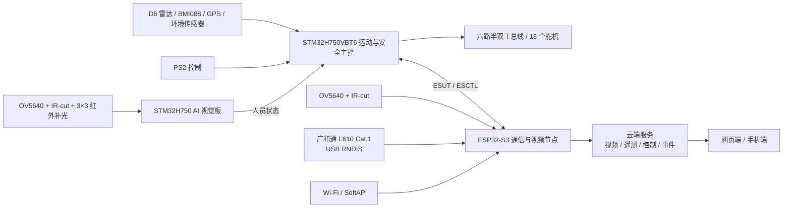

# ⚡ 智巡六足 AI 救援机器人

> 赛事：全国大学生物联网设计竞赛<br>
> 奖项：全国二等奖<br>
> 年份：2026　平台：广和通 L610<br>
> 团队：V-LINK　学校：广东技术师范大学

## 📖 作品简介

智巡六足 AI 救援机器人面向建筑灾害、地下管廊、矿井、野外搜救和危险环境巡检，针对人工进入危险区域侦察风险高、轮式设备越障能力有限，以及弱网环境下视频、控制和定位链路容易中断等问题，构建了集运动控制、端侧视觉、环境感知和物联网通信于一体的六足机器人系统。机器人以 STM32H750 为运动与安全控制核心，配合独立 AI 视觉板、ESP32-S3 视频通信节点和广和通 L610 Cat.1 模块，实现六足 18 舵机运动、姿态稳定、360° 激光避障、人员检测、环境监测、双源定位、视频回传和远程控制。系统将运动安全闭环保留在本地，并通过 4G、Wi-Fi 和 SoftAP 提供远程协同与现场维护能力，提升复杂环境下的侦察效率、信息获取能力和作业安全性。

## 🧠 核心功能

- 六足 18 舵机运动控制，支持基础步态、越野高抬腿和三档速度控制
- BMI088 姿态采集、姿态估计与运动补偿，异常时自动退化为基础步态
- D6 360° 激光雷达距离分区、方向约束和自主脱困
- GPS/北斗定位，无卫星定位时使用 L610 基站定位并记录位置来源
- 温度、湿度、气压、海拔和 MQ-2 可燃气体风险状态采集
- 独立 H750 AI 视觉板执行端侧人员检测并生成事件
- ESP32-S3 摄像头采集、JPEG 视频传输和现场 SoftAP 配置
- 广和通 L610 Cat.1 与 Wi-Fi 双上行，支持网络诊断、切换和恢复
- 云端网页、手机端和现场配置端提供控制、视频、定位、传感器、事件和网络管理

## 🏗️ 系统架构



系统由运动与安全控制域、端侧视觉域和通信域组成。STM32H750 主控负责本地运动目标仲裁、雷达约束、步态规划、逆运动学和控制超时保护；独立视觉板负责人员检测；ESP32-S3 负责视频采集、数据协议和网络管理；L610 通过 USB RNDIS 提供 Cat.1 广域网络，Wi-Fi 和 SoftAP 提供备用通信与现场维护入口。

## 📁 目录结构

```text
├── README.md
├── docs/                       # 项目文档、设计报告与通信资料
│   └── project/
├── hardware/                   # 硬件设计资料
│   ├── pcb/                    # PCB 工程文件
│   ├── mechanical/             # 结构与 3D 模型
│   └── bom.csv                 # 物料清单
├── firmware/                   # 设备底层固件源码
│   ├── h750/                   # STM32H750 主控与运动控制
│   └── esp32_l610/             # ESP32-S3、视频与 L610 通信固件
├── edge_computing/             # 边缘计算与智能算法
│   ├── algorithm/              # 业务算法代码
│   ├── ai_model/               # 模型训练与部署文件
│   └── requirements.txt        # 环境依赖
├── cloud/                      # 云端平台服务
│   ├── iot_platform/           # 设备接入、协议服务与事件存储
│   ├── web_frontend/           # 数据可视化网页
│   └── mobile_app/             # Android / Windows 客户端
└── tools/                      # 构建、调试与部署脚本
```
